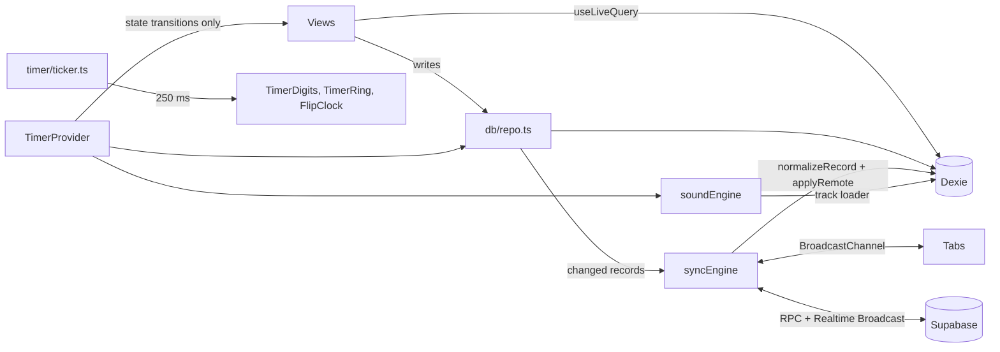

# Design Document (Version 2)

## Overview

Version 2 extends the existing Vite + React + TypeScript + Dexie codebase. It keeps the repository and sync engine and the pure statistics, and changes four areas:

1. **Data model**: new tables, renamed tables (`sessions` to `focusSessions`, `notes` to `quickNotes`, `settings` to `userSettings`), richer tasks and sessions, and a Dexie upgrade that converts version 1 data.
2. **Timer**: three modes, breaks, strict-mode failure, and a separate ticker so the one-second tick reaches only the digit components.
3. **Sound**: two more procedural sounds, uploaded MP3 playback through the same ducking chain, and an eye-rest tone.
4. **Views**: the Syllabus Tracker, Evening Review and Settings become full pages. Sync, data management and profile move into Settings.

## Architecture



### Routing

The URL hash selects the page: `#/` Dashboard, `#/syllabus`, `#/report`, `#/review`, `#/settings` (optionally `#/settings/sync`). The Full-Screen Clock is an overlay. The task dialog and the Milestones drawer are portals.

### File layout (new or changed)

```
src/types.ts                 v2 types
src/db/defaults.ts           DEFAULT_SETTINGS, NO_REPEAT, NO_FILTERS
src/db/migrate.ts            pure normalizers for every table, legacy table names
src/db/db.ts                 Dexie versions 1 to 3 with upgrade
src/db/repo.ts               writes for every table, factory reset, audio files
src/db/builtin.ts            the four built-in reflection questions
src/db/demo.ts               Load Demo Data, Remove Demo Data
src/lib/repeat.ts            next occurrence of a repeating task
src/lib/target.ts            task target labels and Pomodoro counts
src/lib/reminders.ts         which reminders are due
src/lib/syncId.ts            random private Sync ID
src/timer/timerMachine.ts    v2 pure state machine
src/timer/ticker.ts          isolated tick store
src/timer/TimerProvider.tsx  transitions, logging, bells, breaks, strict abort
src/timer/TimerReadout.tsx   memoized digits, ring and bar
src/audio/soundEngine.ts     procedural sounds, custom tracks, bell, eye-rest tone
src/hooks/useReminders.ts    reminder banner and notifications
src/components/syllabus/*    Syllabus Tracker
src/components/review/*      Evening Review page
src/components/settings/*    Settings page
src/components/clock/*       Full-Screen Clock (flip, digital, break screen, strict mode), Mini Timer
src/components/modals/TaskModal.tsx  Priority Filter create and edit dialog
```

## Data Models

```ts
interface Syncable { id: string; updatedAt: number; deleted?: boolean }

interface Subject extends Syncable { name: string; color: string; order: number }
interface Chapter extends Syncable {
  subjectId: string; title: string; order: number;
  status: 'not_started' | 'ongoing' | 'completed';
  theoryDone: boolean; practiceDone: boolean; revisionDone: boolean;
  pastQuestionsSolved: number; createdAt: number;
}
interface RepeatRule { kind: 'never' | 'daily' | 'weekdays' | 'weekly' | 'interval'; intervalDays: number }
interface Task extends Syncable {
  title: string; subjectId: string; chapterId: string | null;
  category: 'current' | 'pending'; column: 'current' | 'pending' | 'completed';
  priority: 'urgent' | 'high-yield' | 'normal'; dueDate: string | null;
  targetMode: 'pomodoro' | 'unit' | 'none';
  estimatedPomodoros: number; pomodoroMinutes: number;
  unitTarget: number; unitLabel: string; unitDone: number;
  subtasks: Subtask[]; quickRevision: boolean; savedSubtasks: Subtask[] | null; savedEstimate: number | null;
  filters: TaskFilters; problemsSolved: number; mesh: 0 | 1 | 2 | 3;
  repeat: RepeatRule; reminderTime: string | null; seriesId: string | null;
  createdAt: number; completedAt: number | null;
}
interface FocusSession extends Syncable {
  taskId: string | null; subjectId: string | null; chapterId: string | null;
  category: Category | null; quickRevision: boolean;
  mode: 'pomodoro' | 'quickstart' | 'stopwatch'; status: 'completed' | 'failed_strict';
  segments: Segment[]; start: number; end: number; durationMs: number;
  plannedMinutes: number; createdAt: number;
}
interface Block extends Syncable { kind: 'class' | 'break'; label: string; start: number; end: number }
interface QuickNote extends Syncable { text: string; context: string; createdAt: number; resolved: boolean }
interface DayMeta extends Syncable { restDay: boolean; dailyNote: string }            // id = YYYY-MM-DD
interface HydrationLog extends Syncable { date: string; glassesCount: number; dailyTarget: number } // id = date
interface ReflectionQuestion extends Syncable { text: string; order: number; builtIn: boolean; createdAt: number }
interface EveningReview extends Syncable {                                              // id = date
  date: string; answersByQuestionId: Record<string, string>; hydrationCount: number; tomorrowFirstTaskId: string | null;
}
interface Goal extends Syncable { title: string; target: number; progress: number; unit: string; createdAt: number }
interface UserSettings extends Syncable {                                               // id = 'app'
  displayName: string; avatarDataUrl: string | null; targetExamTitle: string; targetExamDate: string | null;
  dailyGoalMinutes: number; hydrationGoal: number; defaultPomodoroMinutes: number;
  shortBreakMinutes: number; longBreakMinutes: number; longBreakEvery: number;
  clockStyle: 'flip' | 'digital'; eyeRestEnabled: boolean; bellEnabled: boolean; bellIntervalMinutes: number;
}
interface CustomAudioFile { id: string; name: string; type: string; size: number; blob: Blob; createdAt: number } // device only
```

Decisions:

- **Chapter time is computed, not stored.** `totalMinutesSpent` comes from counted sessions: the session's `chapterId`, or its task's `chapterId`. A stored total would conflict between devices and drift from the report.
- **The profile picture** is resized to at most 192 px and stored as a JPEG data URL (about 15 KB) in `userSettings`. It stays offline in IndexedDB, and it can also travel through JSON and cloud sync. A raw Blob could do neither.
- **Uploaded audio** stays on the device: tracks of several megabytes cannot go through JSON or the free cloud tier. Settings says so, and the student adds tracks on each device. The app calls `navigator.storage.persist()` so the browser keeps them.
- **The Sync ID, theme, volume, last sound, timer selection, mini-timer state and Strict Mode** are device preferences in `localStorage` (`study-space:prefs`).

### Upgrade from version 1

`db.version(2)` adds the new tables and runs an upgrade. `db.version(3)` drops `sessions`, `notes` and `settings`.

1. Copy `sessions`, `notes` and `settings` into `focusSessions`, `quickNotes` and `userSettings`, through `normalizeSession`, `normalizeNote` and `normalizeSettings`.
2. Run `normalizeTask` on every task to fill the new fields.
3. Tombstone every record whose id starts with `seed-` and whose `updatedAt` is still `1`. Such a record came from the old first-run seed and was never edited. Tombstones carry a fresh timestamp, so they also beat the untouched copies in the cloud.
4. Clear the per-room cloud push marks, so the next connect pushes everything under the new table names.

`normalizeRecord(table, raw)` fills defaults and validates enums. It runs on every path where records come in: Dexie upgrade, snapshot import (version 1 and 2), `BroadcastChannel` and cloud pull. `resolveTable` maps legacy table names. All normalizers are idempotent.

## Timer

### State machine (`timerMachine.ts`, pure)

```ts
interface TimerState {
  status: 'idle' | 'running' | 'paused'; phase: 'focus' | 'break';
  mode: 'pomodoro' | 'quickstart' | 'stopwatch';
  minutes: number;                 // Pomodoro length, or the Quick Start continuation length
  taskId: string | null; segments: Segment[]; runningSince: number | null;
  targetMs: number; phaseMs: number; quickStartPending: boolean;
  breakKind: 'short' | 'long' | null; cycle: number;   // focus runs finished since the last long break
}
```

- `start(state, selection, taskId, now, continueMinutes)`, `pause`, `resume`, `addFive` (not for the stopwatch), `startBreak(state, kind, ms, at)`, `finish(state, now)`, `tick(state, now)`.
- `tick` returns `none`, `quick-start-continued`, `finished` or `break-finished`, and the exact moment `at` when the target was reached. The provider starts the break at `at`, not at the tick time. Every tab therefore computes the same state, the same segment boundaries and the same record ids (`run-<start>`, `break-<start>`), so duplicate logging is impossible.
- The stopwatch never finishes on its own. `displayMs` shows elapsed time for the stopwatch and remaining time otherwise.
- `breakKindFor(cycle, every)` gives a long break when the cycle reaches a multiple of `longBreakEvery`.

### Provider and ticker

- `TimerProvider` holds the state in React only for transitions (start, pause, finish, break). Its context value does not change on ticks.
- A 250 ms interval inside the provider runs `tick`, bell crossings, eye-rest crossings and the document title, through refs and without `setState`.
- `ticker.ts` is a tiny external store that emits the current time every 250 ms while a run is active. Only `TimerDigits`, `TimerRing`, `TimerProgressBar` and the flip clock subscribe (`useSyncExternalStore`). They are memoized and use `will-change: transform, opacity`.
- `useLiveSessions` adds the running session to stored sessions with a 30-second clock, so charts move slowly and cheaply.
- One-time sound events go through `claimEvent(id)` in `localStorage`, so only one tab plays each bell even when several are open.
- `abortStrict()` finishes the focus run and logs it with status `failed_strict`.
- Tomorrow's first task comes from yesterday's `eveningReviews` row. It is queued once per day (`study-space:first-task-queued`).

### Strict Mode (clock overlay)

When Strict Mode is on and a focus run is active, the overlay listens to `visibilitychange` and `window.blur`, plus `fullscreenchange` once fullscreen has been entered during the run. Fullscreen is requested only by the clock's full-screen button or by turning Strict Mode on during an active run, never on start, resume, mount or navigation: on Android Chrome a fullscreen request in the same tap as a screen change resizes the viewport and briefly shows the page underneath. The overlay itself is opaque from its first frame (only its content fades in), and closing it waits for any fullscreen exit to settle before unmounting. Monitoring is armed 800 ms after start or resume, so a fullscreen transition does not count as leaving. If fullscreen is refused or never entered, only visibility and blur are watched. Any trigger calls `abortStrict()` and shows a calm message: "The session stopped because the window was left. It is saved as Failed (Strict Mode)."

## Sound engine

Graph: `source -> filters -> noiseGain -> duckGain -> master`. The bell and eye-rest voices connect straight to `master`.

| Choice | Synthesis |
| --- | --- |
| Brown Noise | integrated white noise, low-pass 900 Hz |
| Soft Rain | pink noise wash (high-pass 350, low-pass 5200, shelf) plus a faster band-passed drop layer, slow LFO swells |
| Heavy Rainstorm | dense pink noise wash, a brighter drop layer, and a brown-noise rumble below 160 Hz with a 0.05 Hz swell |
| Deep Space Drone | detuned sine and triangle oscillators at 55, 82.4 and 110.3 Hz through a low-pass filter whose cutoff drifts with a 0.03 Hz LFO, plus faint brown noise |
| Uploaded track | `HTMLAudioElement` (looping, object URL from the stored Blob) through `createMediaElementSource`, so it ducks like the others |

`chime()` is a four-partial bell. `eyeRestTone()` is two soft sine notes. Both dip `duckGain`. A track loader registered at startup reads Blobs from `customAudioFiles`.

## Reminders

`dueReminders(tasks, now)` (pure) returns open tasks with a `reminderTime` whose due date is today, earlier, or unset, once the time has passed and not more than 12 hours ago. `useReminders` checks every 30 seconds and remembers fired keys (`taskId:date`). It shows an in-app banner, and if permission was granted it shows a system notification through `registration.showNotification`. Reminders only fire while the app is open, because there is no push server.

## Repeat rules

`nextDueAfter(rule, base, today)` steps from the base date (the due date, or today when undated) by the rule until the date is after the base and not before today. Weekdays skip Saturday and Sunday, and Custom interval adds `max(1, n)` days. Completing a repeating task creates the next occurrence with the id `<seriesId>@<date>`, only if it does not exist yet. Two devices completing the same task therefore converge on one record.

## Performance rules

- Tailwind's default `transition` property is limited to `opacity, transform`, and the shared easing is `cubic-bezier(0.22, 1, 0.36, 1)`. Progress bars use `scaleX`. Framer-motion uses tweens with the same easing, and no `layout` animations.
- `backdrop-blur` is allowed only in `ui/Modal`, `ui/Drawer`, `layout/BottomNav`, `clock/*`, and popover menus. A source-scan test enforces this.
- Solid surfaces everywhere else. The Overview stat cards use near-opaque solid colours over the banner instead of blur.

## Data management

- **Load Demo Data** writes `demo-` records with fresh timestamps: four subjects with chapters, mixed tasks (Pomodoro, unit, untimed, repeating with a reminder), 30 days of sessions including Quick Start, stopwatch and one strict-mode failure, hydration logs, and one evening review.
- **Remove Demo Data** tombstones `demo-` and `seed-` records.
- **Delete All Data** tombstones every synced record (so other devices clear too), restores default settings and the built-in questions with fresh timestamps, deletes uploaded tracks, and resets the timer.

## Correctness properties

1. Subject totals equal the period total. Percentages are integers that sum to 100.
2. Today ≤ this week ≤ total, for focus time and for completed tasks.
3. Failed strict-mode sessions never change any focus total, streak or goal.
4. Marking a rest day never lowers the streak or the consistency.
5. Quick Revision on then off restores the task exactly.
6. `nextDueAfter` is after the base, not before today, and never a weekend for Weekdays.
7. Normalizers are idempotent and accept every version 1 record.
8. Merges keep the newest version, and are idempotent and independent of order.
9. Timer: elapsed equals wall time minus pauses. Quick Start continues into the default length in one run. Breaks start at the exact finish moment. The stopwatch never finishes on its own.
10. Reminders fire once per task per day, only for open tasks, after their time.

## Testing strategy

Vitest with fast-check (200 to 300 runs per property), repository tests on `fake-indexeddb` (including the version 1 upgrade), and a jsdom smoke test of the whole app from an empty database. Source scans check for emoji, banned wording, `backdrop-blur` outside allowed files, and layout-property transitions.

---

# Version 3 Design

## Flash-free navigation

- Views were already imported eagerly; the flash came from two other places. The view wrapper faded in from `opacity: 0`, which showed a blank card for a frame, and every `useLiveQuery` hook started from an empty default on mount, so a view showed its empty state ("Your study board is empty") for a frame before data arrived.
- `src/db/liveStore.ts` replaces direct `useLiveQuery` calls. Each query (by key) is one shared Dexie `liveQuery` subscription with a cached last value read through `useSyncExternalStore`. A view that mounts again renders the cached value in its first frame. Six components that call `useTasks()` now share one IndexedDB read instead of six, which also helps the Galaxy A50.
- The view swap has no animation. `index.html` sets the page background with an inline `<style>` keyed on the `dark` class, which the existing inline script adds before first paint.

## Data model additions (Dexie version 4, snapshot version 3)

| Table | Id | Fields |
| --- | --- | --- |
| `questionLogs` | `q-<deviceId>-<t.taskId or c.chapterId>-<day>` | `day`, `taskId`, `chapterId`, `subjectId`, `count` (may be negative after a minus), `createdAt` |
| `scheduleDays` | `weekday-<0..6>` (0 = Sunday) | `weekday`, `active`, `slots: { id, start "HH:MM", end "HH:MM", label }[]` |
| `scheduleOverrides` | date `YYYY-MM-DD` | `date`, `slots` (empty list = no classes that date) |
| `tests` | random, or `<seriesId>@<date>` for repeats | `title`, `kind`, `date`, `repeatEveryDays`, `seriesId`, `subjectIds`, `chapterIds`, `totalMarks`, `targetPercent`, `createdAt` |
| `testResults` | the test id | `testId`, `scored`, `total`, `subjects: { subjectId, scored, total }[]`, `rank`, `percentile`, `mistakes: { conceptual, calculation, timePressure, guessed }`, `weakChapterIds`, `reflection`, `createdAt` |

`userSettings` gains `overviewMetrics` and `reviewMetrics` (2 to 4 metric ids each). `Task.problemsSolved` and `Chapter.pastQuestionsSolved` are removed from the model.

**Why question logs are aggregated per device, source and day.** One record per tap would grow without bound. One record per task would lose increments when two devices add questions on the same day, because sync is last-write-wins per record. A record per device, source and day only ever has one writer, so increments never conflict, and the number of records stays small (a few per day). Day, week and total counts are plain sums.

**Carrying over version 2 counts.** The Dexie upgrade, and `validateSnapshot` for version 1 and 2 backups, create one log per task (`q-v2-task-<id>`) and one per chapter (`q-v2-chapter-<id>`). Deterministic ids mean two devices that upgrade the same synced data write the same record instead of doubling it. A task with a question-word unit target takes the larger of its unit count and its old problems counter, since both tracked the same work. Logs are dated to the task's completion or creation day, so they do not inflate "today".

**Question units.** `isQuestionUnit(label)` matches Questions, PYQs, Problems, MCQs and Numericals. For those tasks the target shows `<question count>/<target> <label>`. Other unit labels (Pages, Lectures) keep using `unitDone`.

## Schedule

`effectiveSlots(date, scheduleDays, overrides)` returns the override for that date when one exists, otherwise the weekday's slots when the weekday is active. `scheduledBlocks(date, ...)` turns them into virtual class blocks with ids `schedule-<date>-<slotId>`. The timeline, the class-hours metric and the Pomodoro Records grid use stored blocks plus these virtual blocks. "Edit for today" and the This Week tab write a `scheduleOverrides` record; "Reset to weekly" deletes it.

## Tests

`ensureTestOccurrences(today)` runs at startup and when the day changes: for each repeating series whose latest occurrence is in the past, it creates `<seriesId>@<date>` on the first matching date on or after today, unless that id exists. Fix tasks use ids `fix-<testId>-<chapterId>`, so pressing the button twice creates nothing new. Report charts: score trend (percentage per result, with the target as a dashed line) and a stacked mistake breakdown.

## Metrics

`src/lib/metrics.ts` defines the eight metric ids, labels and a pure `computeMetric(id, ctx)`. `useMetricContext(date)` gathers the inputs once. `components/ui/MetricsPanel.tsx` renders a grid of chosen metrics with a Customize popover (checkboxes, 2 to 4) and is used by both the Overview card and the Evening Review.

## Timer changes

- `TimerState.carriedMs` holds focus time from earlier pieces of the same run. `elapsedMs` adds it, so the countdown, bell and eye-rest timing continue across a task switch, while only `segments` are logged.
- `switchTask(state, taskId, now)` closes the current pieces as a completed run for the old task and continues with `carriedMs` increased. Pieces under a minute are dropped by `addSession` as before, so a quick correction does not log anything.
- `complete()` during focus logs the run and, when the run is at least a minute and the break length is above zero, starts the break at once. `breakMinutesFor(focusMs, cycle, settings)` implements Requirement 26.3. `startNextBlock()` ends the break and starts focus with the same selection and task.
- `abortStrict(at)` closes the run at `at`, the moment the app was left.

## Strict Mode monitor

`src/timer/StrictMonitor.tsx` is mounted once in `App`. During a strict focus run it listens to `visibilitychange` and, in the Android app, `App.appStateChange`. On leaving it records `leftAt`, schedules a 3-second timer, and in the Android app also schedules a native local notification for `leftAt + 3 s`, because the WebView may pause JavaScript in the background. On return within 3 seconds it cancels both. If the timer fires, or the app returns after more than 3 seconds, it calls `abortStrict(leftAt)` and shows the Failed (Strict Mode) notice and a system notification.

## Android (Capacitor 8)

- `capacitor.config.ts`: app id `app.studyspace`, `webDir: 'dist'`, Android background `#0B0D12`.
- `src/native/platform.ts`: `isNativeApp()` and `isAndroidBrowser()`. Plugins are imported dynamically, so the web bundle does not load them.
- `src/native/timerNotification.ts`: in the app, `@capawesome-team/capacitor-android-foreground-service` shows an ongoing notification with buttons (ids 1 Pause or Resume, 2 +5 Min, 3 Complete or Stop) and is updated on every timer change and every 15 seconds. The service is declared with `foregroundServiceType="specialUse"`, which suits a user-started timer; the plugin calls `startForeground` without a type, so Android uses the manifest type. In Chrome on Android, `navigator.mediaSession` metadata, position state and handlers (play, pause, seekforward = +5 min, nexttrack = Complete) are set while a silent 10-second WAV loop plays.
- `src/native/nativeReminders.ts`: rebuilds the next 7 days of task reminders and test alerts with `LocalNotifications.schedule` whenever tasks or tests change (debounced). Ids are 31-bit hashes of the reminder key, and earlier pending ids are cancelled first.
- `main.tsx` skips `registerSW` in the app.
- Building the APK needs the Android SDK and Android Studio, which are not part of this repository; the README lists the steps.

## Version 3 correctness properties

- P13: Question totals for a task, chapter, subject or day equal the sum of matching log counts, and are never below zero when shown.
- P14: Migrating version 2 counts twice (two devices, or an upgrade plus a backup import) produces the same records, so totals do not double.
- P15: `switchTask` preserves the displayed remaining time and the total logged time across the switch.
- P16: `effectiveSlots` returns the override when present, the weekday slots when active, and nothing otherwise.
- P17: `ensureTestOccurrences` is idempotent, and the next occurrence is never before today.
- P18: `breakMinutesFor` follows Requirement 26.3 for every input.

## End-to-end encryption (Requirement 33)

- `src/sync/cryptoUtils.ts`: `deriveSyncKey(passphrase, syncId)` runs PBKDF2-SHA-256 (100,000 iterations, salt `study-space:sync:v1:<Sync ID>`) once and keeps the 256-bit result as a non-extractable HKDF key. `encryptPayload` draws a 16-byte salt and 12-byte IV, derives that payload's AES-256-GCM key with HKDF-SHA-256 (salt = payload salt), and binds `study-space/<table>/<record id>` as additional data. Running PBKDF2 per record was rejected: about 100 to 300 ms each on a Galaxy A50 would make a first sync of a few thousand records take minutes. `encryptBackup` and `decryptBackup` use PBKDF2 directly with a random salt stored in the file, so a backup opens with the passphrase alone under any Sync ID.
- `src/sync/passphrase.ts`: the passphrase lives in localStorage under `study-space:sync-passphrase`, outside the prefs object; other tabs restart sync on the storage event. Storing a non-extractable key in IndexedDB instead was considered; it would protect the passphrase from page scripts but tie encrypted backups to one Sync ID, and the request asked for local storage.
- `src/sync/syncEngine.ts`: on connect the whole room is pulled and decoded before anything is applied; a failed decryption pauses (`status: 'paused'`, `pauseReason`) with no retry loop, since retrying cannot fix a passphrase. Push marks are kept per room and key fingerprint, so turning encryption on or changing the passphrase uploads every record again. Live broadcasts carry `{ id, data: envelope }`.
- Server: `study_sync_push` also replaces a row of the same `updated_at` when the incoming copy is encrypted and different. This lets encrypted copies replace plain ones and re-keyed copies replace old ones, while a plain copy can never replace an encrypted one. Older functions keep working; the app reports remaining plain copies and refuses to change the passphrase if old copies would be left behind.
- Visible to the server: room hash, table names, record ids and update times. Encrypting record ids was rejected because the server needs stable ids to merge versions and to replace plain copies in place.
